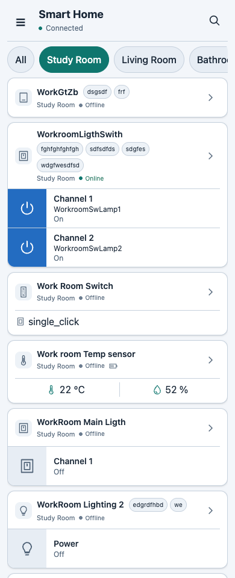
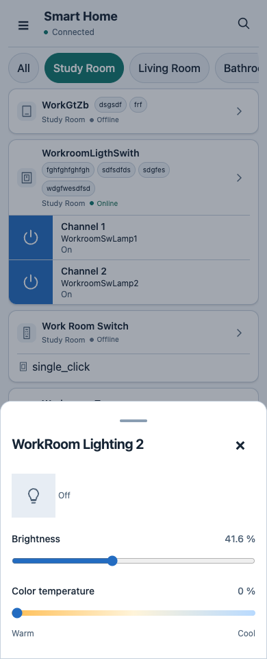
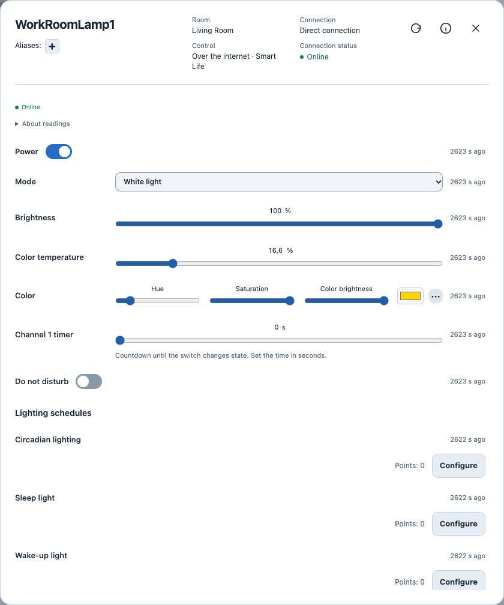
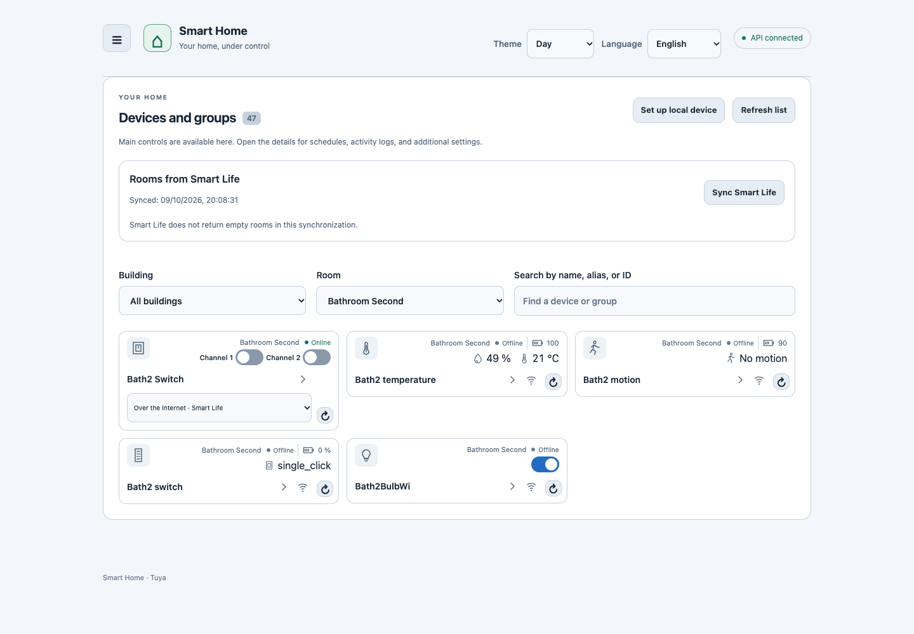
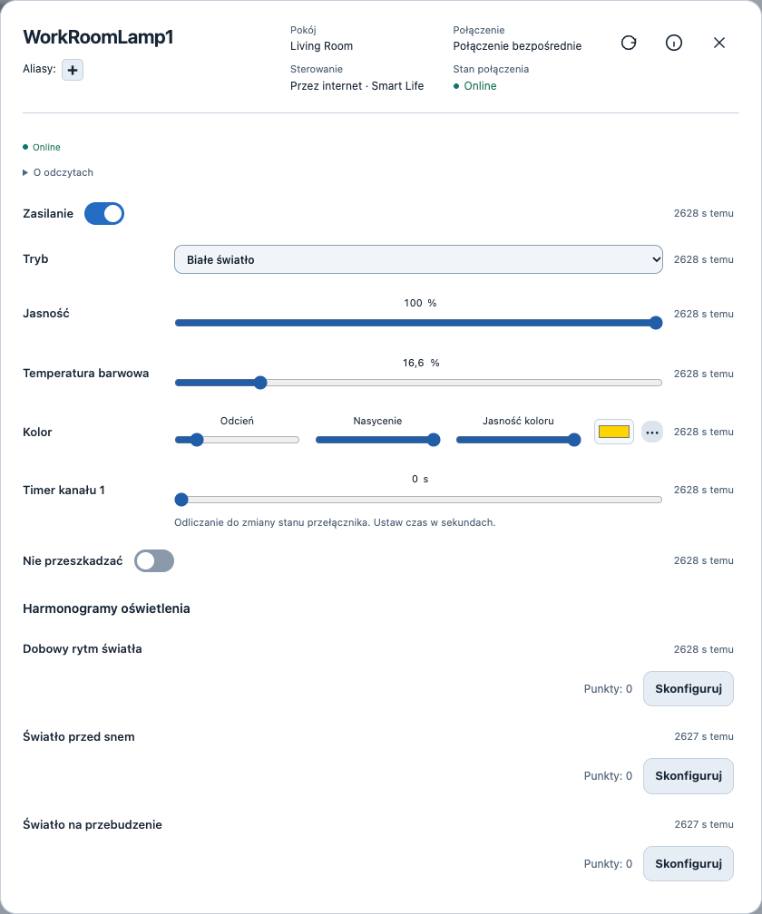
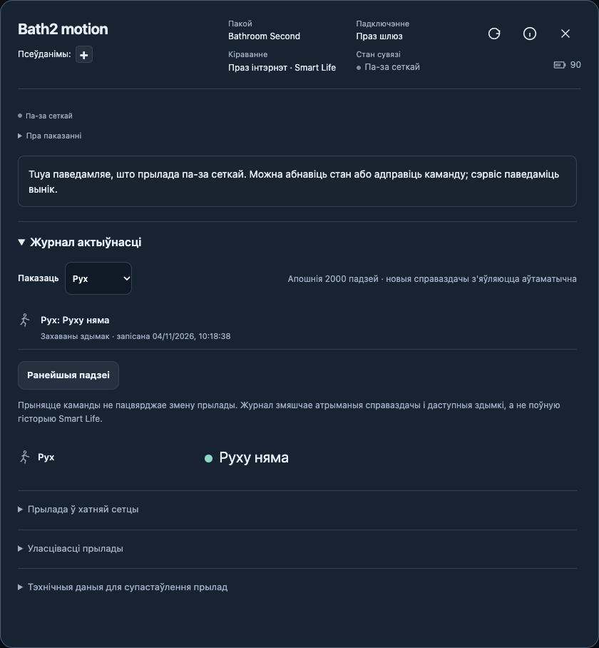

# Smart Home

A home dashboard and REST API for Tuya devices: control lights, read sensors, view camera video, and configure local connections from one interface.

Run it on your own server with Docker, or run the Python API and React interface separately. Local Wi-Fi and Zigbee gateway control uses TinyTuya; optional Smart Life and Tuya Developer connections provide cloud access. Each device has one card with an explicit choice of control method when several are available.

**English · Russian · Polish · Belarusian** | **System · Dark · Day themes** | **Large · Small dashboard cards**

[Quick start](#quick-start) · [Screenshots](#screenshots) · [Localization examples](#localization-examples) · [Documentation](#documentation) · [API reference](docs/api-reference.md)

## What you can do

- Control power and individual switch channels directly from device cards. Tap a supported light card for quick brightness and white temperature controls. Open full details for color, timers, and supported lighting schedules and effects.
- Read temperature, humidity, motion, and battery information; inspect the device activity log and the source and age of readings.
- Search by name or alias, filter by room/building, edit device and channel aliases inline, and link directly to a device's details.
- Open compatible camera HLS streams from the dashboard, with privacy and detection controls when the device exposes them.
- Discover LAN announcements and configure local device connections with separate discovery, verification, and confirmation before saving.
- Manage buildings, rooms, device types, groups, capabilities, and imports through the REST API.

Controls depend on the functions exposed by the device and the selected connection. Unknown or unsupported parameters remain read-only. Zigbee devices use a configured gateway; the network page observes LAN traffic and does not capture Zigbee radio traffic.

## Screenshots

Real views of connected lights, switches, and sensors in English. Device names, aliases, and room assignments remain as configured in the captured installation.

### Device overview

Large cards in the Day theme show power controls, independent switch channels, aliases, room, and connection status.


### Phone dashboard

The phone dashboard shown here uses Large cards. Choose **Menu → Card size** to change the layout. The browser remembers your choice.



### Phone quick controls

Tap a supported light card to open a bottom sheet for power, brightness, and warm-to-cool white temperature. Tap the card’s chevron to open full device details.



### Bulb: brightness, white temperature, and schedules

The example bulb exposes white/color modes, brightness, color temperature, a color picker, a timer, and lighting schedules. The main card provides immediate power control; the full card contains the lighting settings.


### Bulb: precise color controls

Expand the color row to see hue, saturation, and color brightness. Opening this panel does not change the light. Controls send changes automatically; sliders wait briefly for editing to stop.



### Two-channel switch

Both channels have their own control and existing alias tags. A clock opens the channel timer; power-on behavior and backlight are under Additional settings — Dark theme.


### Room filter and sensor cards

A room filter groups motion, temperature/humidity, and lighting devices. Compact cards show readings, battery information, and main controls — Day theme.



### Temperature and humidity sensor

Sensor details show labels, units, battery information, and gateway connection context — Day theme.


### Motion sensor and activity log

The motion sensor has a dedicated status and activity log, shown here with the Motion filter selected — Dark theme. Its motion reports and event history are read-only.


[Screenshot capture details and refresh instructions](docs/screenshots/README.md)

## Localization examples

The interface supports English, Russian, Polish, and Belarusian. Choose **Menu → Language** to change labels, help text, parameter values, and date formatting. Device names, aliases, identifiers, and commands retain their original values. The preference is saved independently of the API key and theme.

### Polish: bulb controls

Power, mode, brightness, color temperature, precise color controls, and lighting schedules in Polish — Day theme.



### Belarusian: motion sensor and activity

Motion state, event filtering, dates, and connection information in Belarusian — Dark theme.



## Quick start

### Docker

Docker Compose builds separate frontend and backend images and serves them at the same browser address. From the repository root:

```sh
cp .env.example .env
chmod 600 .env
python3 -c 'import secrets; print(secrets.token_hex(32))'
```

Set `SMART_HOME_API_TOKEN` in `.env` to the generated value. To use Smart Life or Tuya Developer, also set `SMART_HOME_CLOUD_ENABLED=1`.

```sh
docker compose up -d --build --wait
```

Open `http://localhost:8080` or `http://<server-address>:8080`. In **Menu → Connections**, save the API address and the same service access key from `.env`. This key belongs to your own service; it is separate from Tuya account credentials and device local keys.

Devices and Tuya sessions are stored in the persistent Docker volume. See the [deployment guide](deploy/docker.md) for independent image updates, backups, and Linux host networking for LAN discovery on the Dell 5070.

### Connect your devices

1. **Smart Life:** enable cloud support, then follow the [User Code and QR login guide](docs/qr-login.md). Existing account devices appear without importing them into the local database.
2. **Tuya Developer:** configure your Access ID, Secret, and region using the [Developer connection guide](docs/developer-login.md).
3. **Local network:** use **Menu → Local connections** to discover and verify supported devices, review the results, and confirm which connections to save. Local control needs a device key and a reachable IP; Zigbee children also need their gateway and child address.

Cloud and local connections can coexist. A failed command is not automatically retried through another connection.

## Development

The backend requires Python 3.10+. The frontend requires Node.js `^22.22.2` or `>=24.15.0` and pnpm `11.19.0`, as declared in [frontend/package.json](frontend/package.json).

Start the API in one terminal:

```sh
python3 -m venv .venv
. .venv/bin/activate
python -m pip install -e '.[cloud,dev]'
export SMART_HOME_DB="$PWD/data/smarthome.db"
export SMART_HOME_API_TOKEN='replace-with-your-generated-service-key'
export SMART_HOME_CLOUD_ENABLED=1
export SMART_HOME_CORS_ORIGINS='http://127.0.0.1:5173,http://localhost:5173'
python -m uvicorn smarthome.main:app --host 127.0.0.1 --port 8000 --workers 1
```

Start the interface in another terminal:

```sh
cd frontend
pnpm install --frozen-lockfile
pnpm dev
```

Open `http://127.0.0.1:5173` and save `http://127.0.0.1:8000` and your service key in the connection settings. Swagger is available at `http://127.0.0.1:8000/docs`.

The standalone Python service does not automatically read `.env`; export its settings before starting it. Use one worker and one service instance because device/gateway command locks are held in memory.

### Checks

```sh
python -m pytest -q
ruff check .
cd frontend
pnpm test
pnpm build
```

[VERIFICATION.md](VERIFICATION.md) records previous verification results; [CHANGELOG.md](CHANGELOG.md) records changes.

## Architecture and data

The React + TypeScript + Vite interface calls a FastAPI service. SQLAlchemy and SQLite store configuration, mappings, and observations. TinyTuya handles local devices; the optional Sharing SDK and Developer connection handle cloud access. Production serves the built interface and proxies the API through nginx in one container.

Device local keys and Tuya credentials are handled by the server. The browser stores its service access key and UI preferences. Keep `.env`, databases, Tuya session files, and device exports out of Git; back them up privately. The included HTTP service is intended for a trusted LAN. Use a VPN or an HTTPS reverse proxy for remote access.

Command acceptance and a confirmed device reading are distinct. Logs contain events received since observation began, rather than the complete Smart Life history. See [status updates](docs/status-updates.md) and [activity logs](docs/device-activity.md).

## Documentation

The guides below are in English. Interface language selection is independent of the documentation.

| Topic | Guide |
| --- | --- |
| API, configuration, data model, imports, and examples | [API and operations reference](docs/api-reference.md) |
| UI, navigation, themes, local setup, and device controls | [Frontend guide](frontend/README.md) |
| Docker, Dell 5070, persistent storage, and deployment | [Deployment guide](deploy/docker.md) |
| Smart Life login / Tuya Developer login | [QR login](docs/qr-login.md) · [Developer access](docs/developer-login.md) |
| LAN discovery and packet observation | [Network guide](docs/packet-capture.md) |
| Lighting, switch channels, aliases, and mappings | [Switch controls](docs/switch-controls.md) · [Aliases](docs/device-aliases.md) · [Lighting and mappings](docs/device-linkage.md) |
| Camera controls and limitations | [Camera guide](docs/camera-controls.md) |
| Groups and room displays | [Displays](docs/displays.md) · [CYD firmware](firmware/cyd/README.md) |
| UI translation | [Localization guide](frontend/src/i18n/README.md) |
| Integration choices and supported profiles | [Integrations](docs/integrations.md) |
